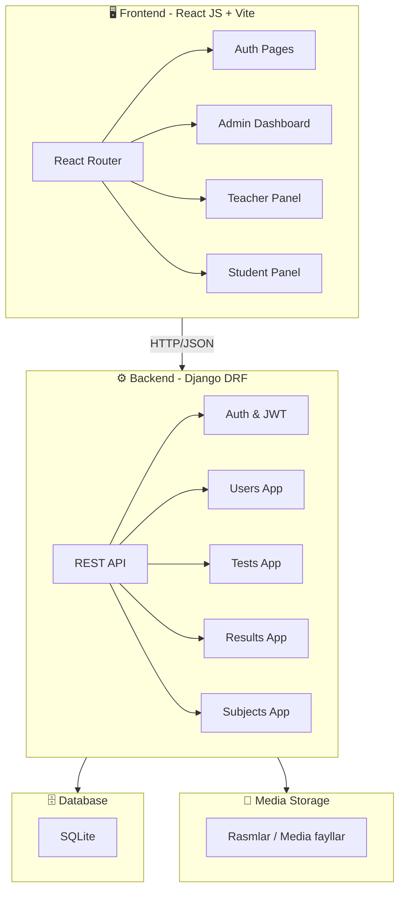
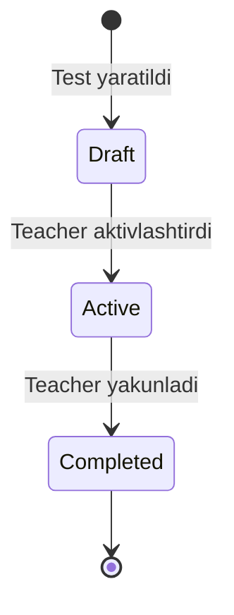
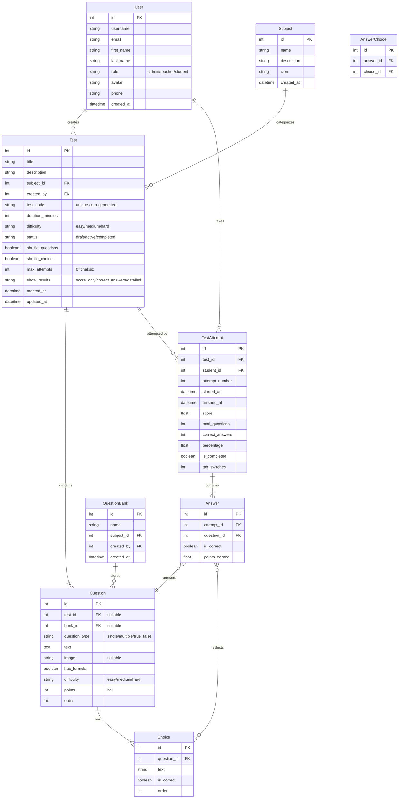

# 🎓 BM_examer — Ishlab Chiqish Rejasi (v2.0)

## Loyiha haqida
**BM_examer** — o'quvchilardan test olish platformasi. O'qituvchilar istalgan fanidan test tuza oladi, o'quvchilar esa testlarni belgilangan vaqt ichida yechadi.

**Texnologiyalar:** Django REST Framework (backend) + React JS (frontend) + SQLite (database)

---

## 📐 Arxitektura



---

## 👥 Foydalanuvchi rollari

| Rol | Imkoniyatlar |
|-----|-------------|
| **Admin** | Barcha foydalanuvchilarni boshqarish, tahrirlash, o'chirish. Barcha testlar va natijalarni ko'rish. Tizim statistikasi. Fanlar boshqaruvi. |
| **Teacher** | Test yaratish/tahrirlash/o'chirish. Savol banki bilan ishlash. Natijalar va statistikani ko'rish. Natijalarni export qilish (PDF/Excel/Word). O'z profilini tahrirlash. |
| **Student** | Testlarni yechish (ro'yxatdan yoki test kodi orqali). O'z natijalarini ko'rish. Progress va tarixni ko'rish. O'z profilini tahrirlash. |

---

## 🎯 Asosiy xususiyatlar

### Savol turlari
| Tur | Tavsif |
|-----|--------|
| **Bitta to'g'ri javob** (Single Choice) | Variantlardan faqat bittasi to'g'ri |
| **Ko'p to'g'ri javob** (Multiple Choice) | Bir nechta variant to'g'ri bo'lishi mumkin |
| **True/False** | Ha yoki Yo'q (Rost yoki Yolg'on) |

### Test kodi tizimi
- Teacher test yaratganda **unikal test kodi** avtomatik generatsiya bo'ladi (masalan: `BM-A1B2C3`)
- Student test kodini kiritib testga kira oladi
- Student shuningdek, mavjud testlar ro'yxatidan ham tanlashi mumkin

### Qayta urinish limiti
- Teacher har bir test uchun **qayta urinishlar sonini** belgilaydi (1, 2, 3, ... yoki cheksiz `0`)
- Tizim student necha marta test yechganini kuzatib boradi

### Test holatlari

- **Draft** — Test hali tayyorlanmoqda, studentlarga ko'rinmaydi
- **Active** — Test faol, studentlar yecha oladi
- **Completed** — Test yakunlangan, faqat natijalar ko'rinadi

### Natija ko'rsatish sozlamasi
Teacher har bir test uchun tanlaydi:
- Faqat ball va foizni ko'rsatish
- To'g'ri javoblarni ham ko'rsatish
- Har bir savolning batafsil tahlilini ko'rsatish

### Savollar va variantlar aralashishi
- Teacher sozlaydi: savollar tartibi aralashtiriladimi
- Variantlar tartibi ham aralashtiriladimi
- Anti-cheating uchun muhim

### Savolga media qo'shish
- Savol matniga **rasm** biriktirish imkoniyati
- Savol matnida **matematik formulalar** yozish imkoniyati (MathJax/KaTeX)

### Savollarni import/export
- Savollarni **Excel** formatda yuklash va yuklab olish
- Savollarni **Word** formatda yuklab olish
- Natijalarni **PDF** formatda yuklab olish

### Anti-cheating
- Tab almashtirish (tab switch) aniqlash va hisoblash
- Fullscreen mode (ixtiyoriy)

---

## 🗃️ Ma'lumotlar bazasi modellari



> [!NOTE]
> `Answer` va `Choice` orasida ko'p-ko'p (many-to-many) aloqa `AnswerChoice` orqali — bu **ko'p to'g'ri javobli** savollar uchun kerak.

---

## 🔧 API Endpoints

### Auth
| Method | Endpoint | Tavsif |
|--------|----------|--------|
| POST | `/api/auth/register/` | Ro'yxatdan o'tish |
| POST | `/api/auth/login/` | Tizimga kirish (JWT) |
| POST | `/api/auth/refresh/` | Token yangilash |
| GET | `/api/auth/profile/` | Profil ma'lumotlari |
| PUT | `/api/auth/profile/` | Profilni tahrirlash |
| POST | `/api/auth/change-password/` | Parolni o'zgartirish |

### Users (Admin)
| Method | Endpoint | Tavsif |
|--------|----------|--------|
| GET | `/api/users/` | Barcha foydalanuvchilar (filter, search, pagination) |
| GET | `/api/users/{id}/` | Bitta foydalanuvchi |
| PUT | `/api/users/{id}/` | Tahrirlash |
| DELETE | `/api/users/{id}/` | O'chirish |
| GET | `/api/users/stats/` | Foydalanuvchilar statistikasi |

### Subjects
| Method | Endpoint | Tavsif |
|--------|----------|--------|
| GET | `/api/subjects/` | Fanlar ro'yxati |
| POST | `/api/subjects/` | Fan qo'shish (admin/teacher) |
| PUT | `/api/subjects/{id}/` | Fan tahrirlash |
| DELETE | `/api/subjects/{id}/` | Fan o'chirish |

### Tests
| Method | Endpoint | Tavsif |
|--------|----------|--------|
| GET | `/api/tests/` | Testlar ro'yxati (filter by status, subject) |
| POST | `/api/tests/` | Test yaratish (teacher) |
| GET | `/api/tests/{id}/` | Test batafsil |
| PUT | `/api/tests/{id}/` | Test tahrirlash |
| DELETE | `/api/tests/{id}/` | Test o'chirish |
| POST | `/api/tests/{id}/activate/` | Testni aktivlashtirish |
| POST | `/api/tests/{id}/complete/` | Testni yakunlash |
| GET | `/api/tests/by-code/{code}/` | Test kodidan test topish |
| POST | `/api/tests/{id}/start/` | Testni boshlash (student) |
| POST | `/api/tests/{id}/submit/` | Testni yakunlash (student) |
| POST | `/api/tests/{id}/save-answer/` | Javobni saqlash (auto-save) |

### Questions
| Method | Endpoint | Tavsif |
|--------|----------|--------|
| GET | `/api/tests/{id}/questions/` | Savollar ro'yxati |
| POST | `/api/tests/{id}/questions/` | Savol qo'shish |
| PUT | `/api/questions/{id}/` | Savolni tahrirlash |
| DELETE | `/api/questions/{id}/` | Savolni o'chirish |
| POST | `/api/questions/import/` | Savollarni Excel'dan import qilish |
| GET | `/api/questions/export/{test_id}/` | Savollarni Excel/Word'da export qilish |

### Question Bank
| Method | Endpoint | Tavsif |
|--------|----------|--------|
| GET | `/api/question-banks/` | Savol banklari |
| POST | `/api/question-banks/` | Yangi bank yaratish |
| GET | `/api/question-banks/{id}/questions/` | Bank savollarini ko'rish |
| POST | `/api/question-banks/{id}/add-to-test/` | Bankdan testga savol qo'shish |

### Results
| Method | Endpoint | Tavsif |
|--------|----------|--------|
| GET | `/api/results/my/` | O'z natijalarim (student) |
| GET | `/api/results/test/{id}/` | Test natijalari va reyting (teacher) |
| GET | `/api/results/test/{id}/export/` | Natijalarni export (PDF/Excel) |
| GET | `/api/results/attempt/{id}/` | Bitta urinish batafsil |
| GET | `/api/results/stats/` | Umumiy statistika (teacher/admin) |
| GET | `/api/results/leaderboard/{test_id}/` | Test reytingi |

---

## 📁 Loyiha tuzilmasi

```
BM_Exam_project/
├── backend/
│   ├── config/                 # Django project settings
│   │   ├── __init__.py
│   │   ├── settings.py
│   │   ├── urls.py
│   │   └── wsgi.py
│   ├── apps/
│   │   ├── accounts/           # User model, auth, profiles
│   │   │   ├── models.py
│   │   │   ├── serializers.py
│   │   │   ├── views.py
│   │   │   ├── urls.py
│   │   │   ├── permissions.py
│   │   │   └── signals.py
│   │   ├── subjects/           # Fan/kategoriya
│   │   │   ├── models.py
│   │   │   ├── serializers.py
│   │   │   ├── views.py
│   │   │   └── urls.py
│   │   ├── tests_app/          # Test, Question, Choice
│   │   │   ├── models.py
│   │   │   ├── serializers.py
│   │   │   ├── views.py
│   │   │   ├── urls.py
│   │   │   ├── utils.py        # Test code generator, Excel import/export
│   │   │   └── signals.py
│   │   ├── question_bank/      # Savol banki
│   │   │   ├── models.py
│   │   │   ├── serializers.py
│   │   │   ├── views.py
│   │   │   └── urls.py
│   │   └── results/            # TestAttempt, Answer, Stats
│   │       ├── models.py
│   │       ├── serializers.py
│   │       ├── views.py
│   │       ├── urls.py
│   │       └── export.py       # PDF/Excel/Word export
│   ├── media/                  # Yuklangan rasmlar
│   ├── manage.py
│   └── requirements.txt
│
└── frontend/
    ├── public/
    ├── src/
    │   ├── api/                # Axios instance, API calls
    │   ├── components/         # Reusable components
    │   │   ├── common/         # Button, Input, Modal, Timer, MathRenderer
    │   │   ├── layout/         # Navbar, Sidebar, Footer
    │   │   └── charts/         # Statistika grafiklari
    │   ├── pages/
    │   │   ├── auth/           # Login, Register
    │   │   ├── admin/          # Admin dashboard
    │   │   ├── teacher/        # Teacher panel
    │   │   └── student/        # Student panel
    │   ├── context/            # Auth context, Theme context
    │   ├── hooks/              # Custom hooks
    │   ├── utils/              # Helper functions
    │   ├── App.jsx
    │   └── main.jsx
    ├── package.json
    └── vite.config.js
```

---

## 📅 Ishlab chiqish bosqichlari

### 📌 Bosqich 1: Backend asosi (Backend Foundation)
> Django loyihasini yaratish, modellar, autentifikatsiya

- [ ] Django loyihasini sozlash (`config/`)
- [ ] Custom User modeli (role, avatar, phone)
- [ ] JWT autentifikatsiya (djangorestframework-simplejwt)
- [ ] Subject modeli
- [ ] Test modeli (test_code, status, max_attempts, shuffle, show_results)
- [ ] Question modeli (question_type, image, has_formula, points)
- [ ] Choice modeli
- [ ] QuestionBank modeli
- [ ] TestAttempt modeli (attempt_number, percentage, tab_switches)
- [ ] Answer va AnswerChoice modellari
- [ ] Admin panel sozlash
- [ ] Test code generator utility

### 📌 Bosqich 2: Backend API (API Development)
> Barcha CRUD endpointlar va permission'lar

- [ ] Auth API (register, login, profile, change-password)
- [ ] Users API (admin CRUD, stats, filter, search)
- [ ] Subjects API (CRUD)
- [ ] Tests API (CRUD + activate/complete + start/submit + save-answer + by-code)
- [ ] Questions API (CRUD + import/export)
- [ ] Question Bank API
- [ ] Results API (natijalar, reyting, leaderboard, statistika)
- [ ] Permission classlar (IsAdmin, IsTeacher, IsStudent, IsOwner)
- [ ] Export utilities (PDF, Excel, Word)
- [ ] Pagination, filtering, searching
- [ ] API testlari

### 📌 Bosqich 3: Frontend asosi (Frontend Foundation)
> React loyihasini yaratish, routing, auth

- [ ] Vite + React loyihasini yaratish
- [ ] Routing sozlash (React Router)
- [ ] Auth context va protected routes
- [ ] Login/Register sahifalari
- [ ] Axios instance va interceptorlar (JWT refresh)
- [ ] Umumiy komponentlar (Button, Input, Modal, Loader, Timer)
- [ ] MathJax/KaTeX komponent (formulalar uchun)
- [ ] Layout komponentlari (Navbar, Sidebar)
- [ ] Dark/Light mode (Theme context)

### 📌 Bosqich 4: Admin panel (Admin Dashboard)
> Admin funktsionalligi

- [ ] Admin dashboard (statistika: foydalanuvchilar, testlar, natijalar)
- [ ] Foydalanuvchilar ro'yxati va boshqaruvi (filter, search, pagination)
- [ ] Fanlar boshqaruvi (CRUD)
- [ ] Testlar monitoringi (barcha testlar, statuslar)
- [ ] Tizim statistikasi grafiklari

### 📌 Bosqich 5: Teacher panel (Teacher Features)
> O'qituvchi funktsionalligi

- [ ] Teacher dashboard (o'z testlari, statistika)
- [ ] Test yaratish formasi (barcha sozlamalar bilan)
- [ ] Savol qo'shish (tur tanlash: single/multiple/true_false)
- [ ] Savolga rasm yuklash
- [ ] Savol matniga formula kiritish
- [ ] Test tahrirlash va status o'zgartirish
- [ ] Savol banki boshqaruvi
- [ ] Savollarni Excel'dan import qilish
- [ ] Savollarni Excel/Word'da export qilish
- [ ] Natijalar sahifasi (reyting, statistika)
- [ ] Natijalarni PDF/Excel'da export qilish
- [ ] Test kodi ko'rsatish va nusxalash

### 📌 Bosqich 6: Student panel (Student Features)
> O'quvchi funktsionalligi

- [ ] Student dashboard (mavjud testlar, so'nggi natijalar)
- [ ] Mavjud testlar ro'yxati (filter by subject)
- [ ] Test kodini kiritib testga kirish
- [ ] Test yechish sahifasi:
  - [ ] Timer (ortga hisob)
  - [ ] Savol navigatsiyasi (savol raqamlari)
  - [ ] Javob tanlash (radio/checkbox/true-false)
  - [ ] Formulalarni ko'rsatish (MathJax/KaTeX)
  - [ ] Rasmlarni ko'rsatish
  - [ ] Ortga qaytish va javob o'zgartirish
  - [ ] Belgilanmagan savollar indikatori
  - [ ] Auto-save (har bir javob avtomatik saqlanadi)
  - [ ] Tab switch detection va hisoblash
- [ ] Test yakunlash va natija ko'rish
- [ ] Reyting/Leaderboard ko'rish
- [ ] O'z natijalari tarixi

### 📌 Bosqich 7: Qo'shimcha funksiyalar (Polish & Extra Features)
> Yaxshilashlar va optimizatsiya

- [ ] Responsive dizayn (mobil qurilmalar)
- [ ] Statistika grafiklari (Chart.js / Recharts)
- [ ] Loading skeletonlar va animatsiyalar
- [ ] Error handling va xabarlar (toast/notification)
- [ ] SEO va performance optimizatsiya
- [ ] Fullscreen mode (test paytida)
- [ ] Bildirishnomalar (test tayinlanganda)

---

## 🎨 UI/UX dizayn konseptsiyasi

- **Ranglar:** Ko'k-binafsha gradient asosiy rang, quyuq fon (dark mode default)
- **Shrift:** Inter yoki Outfit (Google Fonts)
- **Stil:** Glassmorphism elementlari, yumshoq soyalar, zamonaviy kartochkalar
- **Animatsiyalar:** Sahifa o'tishlari, hover effektlar, timer animatsiyasi, progress barlar
- **Responsive:** Barcha qurilmalarda ishlaydi
- **Formulalar:** KaTeX yoki MathJax orqali matematik formulalar

---

## 🛠️ Texnologiyalar to'plami

### Backend
| Texnologiya | Maqsad |
|-------------|--------|
| Python 3.11+ | Dasturlash tili |
| Django 5.x | Web framework |
| Django REST Framework | API |
| djangorestframework-simplejwt | JWT autentifikatsiya |
| Pillow | Rasm ishlov berish |
| openpyxl | Excel import/export |
| python-docx | Word export |
| ReportLab / WeasyPrint | PDF export |
| django-filter | Filterlash |
| django-cors-headers | CORS sozlash |

### Frontend
| Texnologiya | Maqsad |
|-------------|--------|
| React 18+ | UI framework |
| Vite | Build tool |
| React Router v6 | Routing |
| Axios | HTTP so'rovlar |
| KaTeX / react-katex | Matematik formulalar |
| Recharts / Chart.js | Grafiklar |
| React Icons | Ikonkalar |
| React Hot Toast | Bildirishnomalar |

---

> [!IMPORTANT]
> Har bir bosqich tugagandan so'ng test qilinadi va keyingi bosqichga o'tiladi.
> Birinchi bosqichdan boshlaymiz — **Backend asosi**.

> [!TIP]
> Har bir bosqichda commit qilish tavsiya etiladi. Git bilan ishlash rejasi:
> - `main` — barqaror versiya
> - `develop` — ishlab chiqish
> - `feature/*` — yangi xususiyatlar
